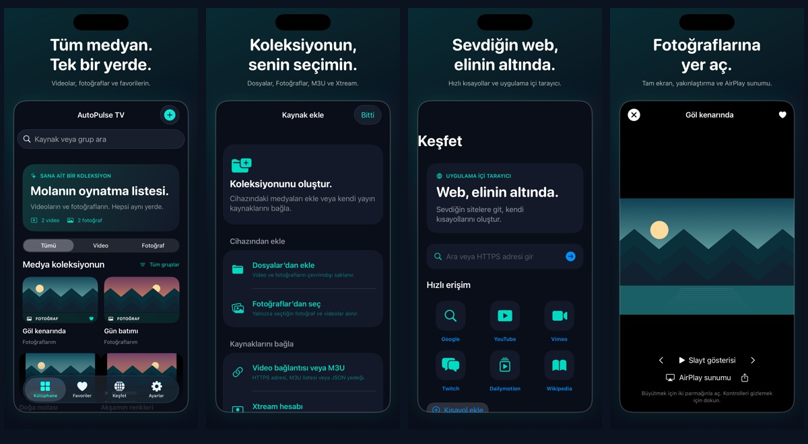

# AutoPulse TV

[](https://github.com/statelyx/AutoPulse-Tv/actions/workflows/ios.yml)


**Kendi video kaynakların, kişisel kütüphanen ve uygulama içi web tarayıcın.**

AutoPulse TV; doğrudan video bağlantılarını ve M3U listelerini kaydetmek, aramak ve oynatmak için geliştirilen yerel bir iOS uygulamasıdır. AirPlay hedef seçimi ve aynı build içindeki resmi CarPlay entegrasyonu içerir.

[English](README.en.md) · [Codemagic kurulumu](docs/CODEMAGIC.md) · [Mimari](docs/ARCHITECTURE.md) · [Değişiklikler](CHANGELOG.md)

## Uygulamadan


Gerçek iPhone simülatöründen alınmıştır. Görünen kaynak UI test verisidir; çalışan bir yayın kataloğu veya CarPlay ekran görüntüsü değildir.

## Özellikler

| Alan | Mevcut kapsam |
| --- | --- |
| Kütüphane | Kaynak ekleme/silme, arama, favoriler, grup bilgisi |
| Medya oynatımı | HTTPS doğrudan HLS/MP4/MOV kaynakları, yerel oynatıcı ve tam ekran |
| Devam etme | Uygun VOD kaynaklarında konumu kaydetme; canlı/bitmiş video için ayrı kurallar |
| Listeler | Uzak veya yerel M3U, göreli adres çözümü, tekrarlı kaynakları ayıklama |
| Yedekleme | JSON dışa aktarma, doğrulanmış geri yükleme ve atomik yerel kayıt |
| Tarayıcı | iPhone/iPad WebKit, adres çubuğu, ileri/geri, yenile/durdur, Safari alternatifi |
| Harici oynatma | Sistem AirPlay hedef seçicisi; alıcı ve kaynak desteğine bağlı |
| CarPlay | Ayrı build seçeneği, yerel katalog şablonları ve video entitlement yapılandırması |

Uygulama hazır TV kanalı, film veya ücretli yayın erişimi sağlamaz. İçerikleri kullanıcı ekler.

## Doğrulanan durum

**1.1.0 (4) TestFlight dahili testte hazır.** Codemagic imzalı build ve App Store Connect yüklemesi başarılı. [Son CI çalışmasında](https://github.com/statelyx/AutoPulse-Tv/actions/runs/42227322556) 10 birim ve 2 UI testi geçti; iPhone/iPad için dört ayrı sayfa yakalandı.

Dosyalar/Fotoğraflar içe aktarma, yerel video/fotoğraf, tam ekran zoom/slayt, PiP, keşif kısayolları ve Xtream uyumlu içe aktarma eklendi. [Sürüm ayrıntıları](docs/RELEASE-1.1.md) · [Güncel teslim durumu](RELEASE-STATUS.md)

[App Store görsel paketi](store/AutoPulseTV-1.1-AppStore.zip) · [Görseller ve kaynak manifesti](store/screenshots/v1.1/README.md)



Yeni tek build yapılandırmasının Apple SDK ve fiziksel AirPlay/araç doğrulaması bekliyor. App Store genel yayınına gönderilmedi.

## Mac üzerinde çalıştırma

Gerekenler: **Xcode, XcodeGen ve iOS 17+**.

```sh
git clone https://github.com/statelyx/AutoPulse-Tv.git
cd AutoPulse-Tv
xcodegen generate
open AutoPulseTV.xcodeproj
```

Xcode'da **AutoPulseTV** scheme'ini seç. Fiziksel cihaza yükleme için kendi Team ve geçerli bundle ID ayarlarını kullan. Varsayılan uygulama kimliği `com.statelyxx.autopulsetv` değeridir; GitHub kullanıcı adından bağımsızdır ve Apple hesabında kaydedilmesi gerekir.

Test, build logları ve gerçek simülatör ekran görüntüsü:

```sh
bash scripts/simulator.sh
```

Çıktılar `build/` altında oluşur. GitHub Actions aynı betiği çalıştırır ve `autopulsetv-verification` artifact'ini yayımlar.

## Codemagic

Depo kökünde [codemagic.yaml](codemagic.yaml) hazırdır:

- **simulator:** imzasız derleme, birim/UI testleri ve ekran görüntüsü. Apple API anahtarı gerekmez.
- **testflight:** dağıtım imzalama ve App Store Connect yüklemesi. Hesaba ait entegrasyon, sertifika, provisioning profile ve uygulama kaydı gerekir.

İlk iş olarak **simulator** seçilmeli. [Adım adım Codemagic rehberi](docs/CODEMAGIC.md)

## CarPlay sürümü

```sh
xcodegen generate
```

Tek `project.yml`, iPhone/iPad ve CarPlay kaynaklarını, explicit Info.plist sahnesini ve audio/video entitlement dosyasını içerir. Uygulamanın minimum sürümü iOS 17'dir; CarPlay delegate mevcut `@available(iOS 27.0, *)` sınırını korur. İmzalama için App ID ve profillerde Apple'ın CarPlay yetkileri gerekir. Video desteklenmiyorsa kaynak listesi ses modunda kalır. Video kullanımını sistem ve araç sınırlar; tarayıcı telefonda kalır.

[CarPlay entegrasyonu ve sınırları](docs/CARPLAY.md)

[CarPlay görevleri ve durumları](docs/CARPLAY-TASKS.md)

## Proje yapısı

```text
Sources/              SwiftUI, kütüphane, oynatıcı ve WebKit
CarPlay/              Araç sahnesi ve audio/video entitlement
Resources/            İkon ve gizlilik manifesti
Tests/ · UITests/     Model ve kullanıcı akışı testleri
scripts/              Simülatör ve statik doğrulama araçları
docs/                 Mimari, CI kanıtları ve kurulum rehberleri
store/                Henüz yayımlanmamış mağaza/gizlilik taslakları
project.yml           Tek XcodeGen proje tanımı
codemagic.yaml        Simülatör ve TestFlight iş akışları
```

## Geliştirme ve geri bildirim

[Katkı rehberi](CONTRIBUTING.md) · [Hata bildir](https://github.com/statelyx/AutoPulse-Tv/issues/new/choose) · [APTV araştırma bulguları](docs/APTV-FINDINGS.md)

Web sitelerinin oturum, DRM ve harici oynatma desteği hizmete bağlıdır. Gerçek araç uyumluluğu, sıfır gecikme veya tüm video sitelerinin çalışması vaat edilmez. Ödeme sistemi ve StoreKit ürünleri henüz uygulanmadı.
