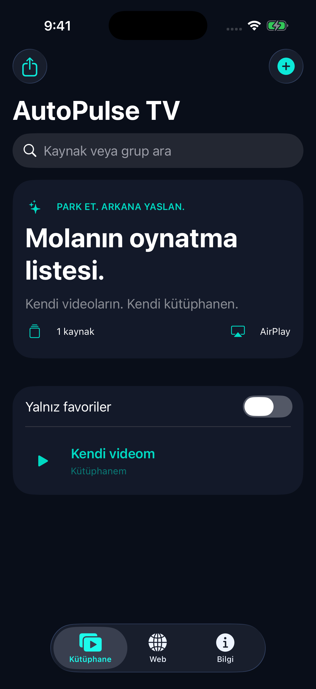

# AutoPulse TV

[](https://github.com/statelyx/AutoPulse-Tv/actions/workflows/ios.yml)


**Kendi video kaynakların, kişisel kütüphanen ve uygulama içi web tarayıcın.**

AutoPulse TV; doğrudan video bağlantılarını ve M3U listelerini kaydetmek, aramak ve oynatmak için geliştirilen yerel bir iOS uygulamasıdır. AirPlay hedef seçimi ve ayrı bir resmi CarPlay video entegrasyonu içerir.

[English](README.en.md) · [Codemagic kurulumu](docs/CODEMAGIC.md) · [Mimari](docs/ARCHITECTURE.md) · [Değişiklikler](CHANGELOG.md)

## Uygulamadan



Gerçek iPhone simülatöründen alınmıştır. Görünen kaynak UI test verisidir; çalışan bir yayın kataloğu veya CarPlay ekran görüntüsü değildir.

## Özellikler

| Alan | Mevcut kapsam |
| --- | --- |
| Kütüphane | Kaynak ekleme/silme, arama, favoriler, grup bilgisi |
| Medya oynatımı | HTTPS doğrudan HLS/MP4/MOV kaynakları, yerel oynatıcı ve tam ekran |
| Devam etme | Uygun VOD kaynaklarında konumu kaydetme; canlı/bitmiş video için ayrı kurallar |
| Listeler | Uzak veya yerel M3U, göreli adres çözümü, tekrarlı kaynakları ayıklama |
| Yedekleme | JSON dışa aktarma, doğrulanmış geri yükleme ve atomik yerel kayıt |
| Tarayıcı | iPhone/iPad WebKit, adres çubuğu, ileri/geri, yenile/durdur, Safari alternatifi |
| Harici oynatma | Sistem AirPlay hedef seçicisi; alıcı ve kaynak desteğine bağlı |
| CarPlay | Ayrı build seçeneği, yerel katalog şablonları ve video entitlement yapılandırması |

Uygulama hazır TV kanalı, film veya ücretli yayın erişimi sağlamaz. İçerikleri kullanıcı ekler.

## Doğrulanan durum

**6 Kasım 2026:** [GitHub Actions çalışması](https://github.com/statelyx/AutoPulse-Tv/actions/runs/42200973648), `2d9be98` commit'inde varsayılan iPhone simülatör derlemesini başarıyla tamamladı. **6 birim testi + 1 UI testi, 0 hata.** Kullanılan ortam Xcode 26.6, iOS 26.5 ve iPhone 17 Pro simülatörüydü.

| Aşama | Durum |
| --- | --- |
| Varsayılan iOS simülatör derlemesi | Başarılı |
| Kütüphane/ayrıştırıcı testleri ve temel UI akışı | Başarılı |
| Gerçek cihazda web video / AirPlay / medya senkronizasyonu | Henüz doğrulanmadı |
| Ayrı CarPlay build'i ve gerçek araç | Henüz doğrulanmadı |
| Codemagic uygulama bağlantısı / derlemesi | Bekliyor |
| İmzalı IPA / TestFlight / App Store | Henüz yayınlanmadı |

[CI kanıtı](docs/verification/2026-11-06-ci.json) · [Cihaz test matrisi](docs/TEST-MATRIX.md)

`VALIDATION.json` yalnız yerel statik kontrolü kaydeder; GitHub'daki Apple SDK derleme/test kanıtı `docs/verification` altında ayrı tutulur.

## Mac üzerinde çalıştırma

Gerekenler: **Xcode, XcodeGen ve iOS 17+**.

```sh
git clone https://github.com/statelyx/AutoPulse-Tv.git
cd AutoPulse-Tv
xcodegen generate
open AutoPulseTV.xcodeproj
```

Xcode'da **AutoPulseTV** scheme'ini seç. Fiziksel cihaza yükleme için kendi Team ve geçerli bundle ID ayarlarını kullan. Varsayılan uygulama kimliği `com.statelyxx.autopulsetv` değeridir; GitHub kullanıcı adından bağımsızdır ve Apple hesabında kaydedilmesi gerekir.

Test, build logları ve gerçek simülatör ekran görüntüsü:

```sh
bash scripts/simulator.sh
```

Çıktılar `build/` altında oluşur. GitHub Actions aynı betiği çalıştırır ve `autopulsetv-verification` artifact'ini yayımlar.

## Codemagic

Depo kökünde [codemagic.yaml](codemagic.yaml) hazırdır:

- **simulator:** imzasız derleme, birim/UI testleri ve ekran görüntüsü. Apple API anahtarı gerekmez.
- **testflight:** dağıtım imzalama ve App Store Connect yüklemesi. Hesaba ait entegrasyon, sertifika, provisioning profile ve uygulama kaydı gerekir.

İlk iş olarak **simulator** seçilmeli. [Adım adım Codemagic rehberi](docs/CODEMAGIC.md)

## CarPlay sürümü

```sh
xcodegen generate --spec project-carplay.yml
```

Bu yapılandırma iOS 27+ SDK, Apple'ın uygun CarPlay video yetkisi ve desteklenen araç gerektirir. Normal iPhone build'inin yeşil CI sonucu CarPlay sürümünün çalıştığını kanıtlamaz. Araç ekranını sistem şablonları düzenler; telefon ekranı yansıtılmaz. Tarayıcı iPhone/iPad üzerindedir. Video uygunluğu sistem ve araç tarafından kontrol edilir.

[CarPlay entegrasyonu ve sınırları](docs/CARPLAY.md)

## Proje yapısı

```text
Sources/              SwiftUI, kütüphane, oynatıcı ve WebKit
CarPlay/              İsteğe bağlı araç sahnesi ve entitlement
Resources/            İkon ve gizlilik manifesti
Tests/ · UITests/     Model ve kullanıcı akışı testleri
scripts/              Simülatör ve statik doğrulama araçları
docs/                 Mimari, CI kanıtları ve kurulum rehberleri
store/                Henüz yayımlanmamış mağaza/gizlilik taslakları
project*.yml          XcodeGen proje tanımları
codemagic.yaml        Simülatör ve TestFlight iş akışları
```

## Geliştirme ve geri bildirim

[Katkı rehberi](CONTRIBUTING.md) · [Hata bildir](https://github.com/statelyx/AutoPulse-Tv/issues/new/choose) · [APTV araştırma bulguları](docs/APTV-FINDINGS.md)

Web sitelerinin oturum, DRM ve harici oynatma desteği hizmete bağlıdır. Gerçek araç uyumluluğu, sıfır gecikme veya tüm video sitelerinin çalışması vaat edilmez. Ödeme sistemi ve StoreKit ürünleri henüz uygulanmadı.
