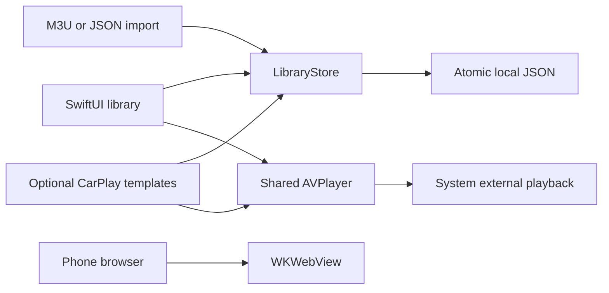

# Architecture

## Shared application services

AutoPulseTVApp injects one LibraryStore and PlaybackController into the SwiftUI tree. The optional CarPlay scene uses the same instances through AppServices. Media sources are represented by MediaSource and persisted in a versioned LibraryBackup.

## Library

LibraryStore validates HTTPS sources, merges imports without URL duplicates and writes atomically. Failed writes do not replace the published in-memory source list. A corrupt file blocks subsequent writes rather than silently replacing the file with an empty library.

M3UParser supports EXTINF titles and group-title metadata, relative URLs from remote playlists, byte/entry limits and HLS manifest detection. JSON import validates source URLs and assigns fresh UUIDs before merging. These are personal media inputs; no channel provider is bundled.

## Playback

PlaybackController owns AVPlayer and the audio session. Native controls handle playback and fullscreen UI. External playback is offered through system mechanisms; the application does not transmit an iPhone framebuffer. PlaybackPositionPolicy prevents invalid/live/completed media positions from being reused as a normal VOD resume point.

The successful simulator CI verifies compilation and selected model/UI behavior, not remote stream playback quality, DRM, AirPlay synchronization or receiver compatibility.

## Browser

BrowserModel owns WKWebView and observes navigation state. HTTPS pages render in the app on iPhone/iPad. It handles navigation failure and web-process termination and offers a Safari view fallback. It does not extract protected streams or turn a web page into a native CarPlay browser.

## CarPlay

project-carplay.yml adds the video scene and entitlement to the base specification. Native templates own the vehicle UI layout. The scene checks receiver capability and passes selected media to the shared player. This configuration is distinct from the verified default iPhone simulator build. See CARPLAY.md for pending validation and supported-system assumptions.

## Build and release

- GitHub Actions: unsigned simulator build, XCTest/UI tests and artifacts.
- Codemagic simulator: the same verification script, no Apple signing required.
- Codemagic testflight: signing/profile integration and App Store Connect upload; account-specific setup is required.
- No production release, StoreKit catalog or App Store approval is represented by a green simulator workflow.
